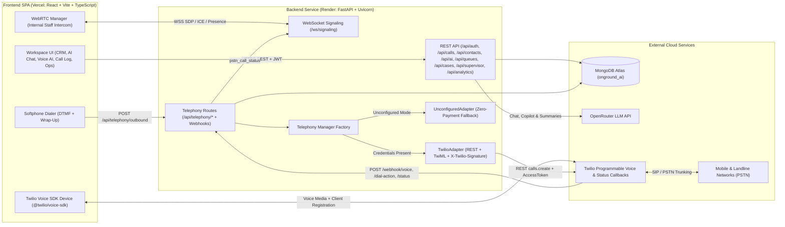

# OnGround AI – Voice & Text Intelligence Platform

OnGround AI is a full-stack call-centre and customer communications platform that unifies browser-based WebRTC voice calling, Twilio PSTN outbound telephony, real-time AI agent assistance, conversational voice/text AI, Customer CRM, and supervisor workforce operations inside a single staff workspace.

It addresses the fragmentation common in customer support teams—where phone dialers, internal team voice tools, CRM records, follow-up queues, and AI response drafting live in separate tools—by connecting a React + TypeScript softphone workspace directly to a FastAPI backend, MongoDB Atlas persistence, OpenRouter LLM intelligence, WebSocket signaling, and Twilio Voice.

[](https://react.dev/)
[](https://vite.dev/)
[](https://fastapi.tiangolo.com/)
[](https://www.mongodb.com/atlas)
[](https://www.twilio.com/voice)
[](https://openrouter.ai/)
[](https://on-ground-ai.vercel.app)
[](https://ongroundai-ac3c.onrender.com/api/health)

---

## Table of Contents

1. [Live Application](#live-application)
2. [Project Overview](#project-overview)
3. [Key Features](#key-features)
4. [Calling Workflow](#calling-workflow)
5. [Technology Stack](#technology-stack)
6. [System Architecture](#system-architecture)
7. [Project Folder Structure](#project-folder-structure)
8. [Local Installation and Setup](#local-installation-and-setup)
9. [Environment Variables](#environment-variables)
10. [API and Webhook Overview](#api-and-webhook-overview)
11. [Twilio Trial Account Limitations](#twilio-trial-account-limitations)
12. [Security Considerations](#security-considerations)
13. [Testing](#testing)
14. [Deployment](#deployment)
15. [Future Enhancements](#future-enhancements)
16. [Conclusion](#conclusion)

---

## Live Application

OnGround AI is deployed using **Vercel** for the React/Vite frontend and **Render** for the FastAPI backend:

| Service | Host | URL |
| :--- | :--- | :--- |
| **Web Application (Frontend)** | Vercel | https://on-ground-ai.vercel.app |
| **API & WebSocket Backend** | Render | https://ongroundai-ac3c.onrender.com |
| **Health & Diagnostics Endpoint** | Render | https://ongroundai-ac3c.onrender.com/api/health |
| **Interactive OpenAPI Docs** | Render | https://ongroundai-ac3c.onrender.com/docs |
| **Source Repository** | GitHub | https://github.com/Abdul561561/OnGroundAI |

> **Note:** Render free-tier services spin down during periods of inactivity; the first request after idle sleep may take several seconds while the container wakes up. The live Render backend is configured with **Twilio** (`provider: twilio`, Twilio Trial account) for outbound REST PSTN calling and browser `<Client>` audio bridging via public HTTPS webhooks; in environments where Twilio credentials are omitted, the codebase cleanly falls back to `UnconfiguredAdapter`.

---

## Project Overview

OnGround AI is built for front-line support agents, team supervisors, and administrators who handle both internal coordination and external customer interactions:

- **Front-Line Agents** manage live shift availability, look up customer profiles by E.164 phone number or name, launch browser WebRTC calls or Twilio PSTN outbound telephone calls from the Softphone Dialer, consult the Agent Assist AI copilot during conversations, track support cases and follow-ups, and review call transcripts and AI summaries.
- **Supervisors and Administrators** monitor live agent WebSocket presence, claim or reassign unassigned customer records and pending follow-ups, inspect incoming queue tickets and AI escalations, manage Knowledge Base articles, and review database-backed operational KPIs.
- **Transparent Telephony Architecture** strictly avoids simulated dialing, fake dial tones, or fabricated connection states: when Twilio credentials are absent, `UnconfiguredAdapter` explains exactly what is required while keeping WebRTC intercom, AI assistants, CRM, and dashboards fully functional.

---

## Key Features

### Authentication and Staff Workspace
- Email/password registration and login backed by `bcrypt` password hashing and stateless HS256 JWT tokens.
- Role-based access control across `agent`, `supervisor`, and `admin` roles (`Agent Workspace`, `Live Call Centre`, `Supervisor Hub`, `System & Carrier` diagnostics).
- Staff presence status updates (`available`, `busy`, `away`, `offline`) and controlled idempotent demo staff seeding (`/api/auth/init-demo-users`).

### Real-Time Human-to-Human Calling (WebRTC)
- Peer-to-peer browser audio calling between online staff members in `UserDirectory` (`Internal Intercom`).
- Authenticated WebSocket signaling (`/ws/signaling`) for online presence updates, SDP offer/answer exchange, and ICE candidate relay using Google STUN servers.
- Live mute toggle, call duration timer, audio level visualization, incoming call accept/reject modal, and automatic DB finalization if a peer disconnects unexpectedly.

### Outbound PSTN Calling via Twilio REST API
- E.164 softphone keypad (`SoftphoneDialer.tsx`) with synthesized Web Audio DTMF keypad tones and direct Click-to-Call integration from Customer CRM, Cases, Live Ops, and Incoming Queues.
- E.164 destination validation (`normalize_and_validate_e164`), automatic CRM contact matching by phone digits, and outbound call initiation through the Twilio Python REST client (`client.calls.create`) using `TWILIO_PHONE_NUMBER` as Caller ID.
- Honest carrier diagnostics (`/api/telephony/status`), Trial fallback retry for restricted callback parameters, and active call termination (`/api/telephony/hangup`).

### Browser-Based Agent Audio Connection
- Twilio Voice SDK (`@twilio/voice-sdk` `Device`) initialized via `/api/telephony/token` using a Twilio Access Token (`VoiceGrant` with `incoming_allow=True`).
- When a customer answers a REST-initiated outbound call, Twilio requests `/api/telephony/webhook/voice` and receives TwiML `<Dial><Client>{agent_id}</Client></Dial>` to bridge PSTN audio to the agent's browser microphone and speakers.
- Optional `"Direct Browser SDK"` mode (`Device.connect()`) becomes available in the UI automatically when `TWILIO_TWIML_APP_SID` is also configured alongside API Key credentials.

### AI-Powered Text Assistant (`CRM Grounded Chat`)
- Persistent multi-conversation text chat (`/api/ai/chat`) powered by OpenRouter (`openrouter/auto` default with selectable free model catalog from `/api/ai/models`).
- Automatically injects Knowledge Base policy articles (`db.knowledge_base`) and optionally binds a selected CRM customer's profile and interaction context.
- Supports creating follow-up support cases directly from a chat session.

### AI Voice Assistant (`Spoken Voice AI`) & Real-Time Agent Assist Copilot
- **Spoken Voice AI** (`VoiceAIAssistant.tsx`): Uses browser Web Speech API (`webkitSpeechRecognition` and `SpeechSynthesis`) with a manual text input fallback, CRM customer binding, support case creation, and one-click escalation into the human agent queue (`/api/queues/escalate`).
- **Real-Time Agent Assist Copilot** (`/api/ai/agent-assist`): Analyzes a customer statement (typed or captured via microphone speech recognition) together with optional CRM context and returns structured JSON containing a recommended spoken reply (with copy and TTS preview), extracted customer needs, action items, and a suggested call outcome.
- **Conversational Phone AI Webhook** (`/api/telephony/ai-phone-turn`): Optional Twilio TwiML `<Gather input="speech">` + `<Say>` turn handler for speech-driven phone IVR prompts.

### Call History and Call Status Tracking
- Unified call audit log (`CallHistory.tsx` & `/api/calls`) tracking both WebRTC peer calls (`provider="webrtc"`) and Twilio PSTN calls (`provider="twilio"`, `provider_call_id=<CallSid>`).
- Real-time PSTN status updates (`queued`, `ringing`, `connected`, `completed`, `busy`, `no_answer`, `failed`, `canceled`) pushed from `/api/telephony/webhook/status` and `/api/telephony/webhook/dial-action` over WebSocket (`pstn_call_status`), backed by Twilio REST status polling (`GET /api/telephony/calls/{call_id}`).
- Integrated post-call wrap-up recording call outcomes (`interested`, `callback_requested`, `voicemail`, `resolved`, `escalated`, `no_answer`, `busy`, `wrong_number`), notes, follow-up tasks, and support cases.

### Call Transcripts, Summaries and Action Items
- Per-call transcript logging (`POST /api/calls/{call_id}/transcripts`, `GET /api/calls/{call_id}/transcripts`) allowing dialogue segments (`Speaker` + `Content`) to be stored and reviewed in the Call Log & Audits view.
- On-demand AI Call Summary generation (`POST /api/calls/{call_id}/summary`) that analyzes stored transcript segments (or supplied transcript text) via OpenRouter and stores structured output formatted into **Executive Summary**, **Key Topics Discussed**, and **Action Items** (`calls.ai_summary`).
- Note: Transcript entries are saved via the call transcript API and UI modal (as well as spoken/text AI dialogue logs); live automated audio-stream transcription of Twilio PSTN calls is not implemented.

### CRM, Queues, Cases, Analytics & Supervisor Operations
- **Customer CRM** (`/api/contacts`): Full CRUD, normalized phone search, interaction timeline (`/api/contacts/{contact_id}/history`), and customer follow-up creation.
- **Incoming Queues & Escalations** (`/api/queues`): Tracks inbound PSTN calls and AI-to-human escalations with ticket claiming and status updates.
- **Support Cases & Follow-Ups** (`/api/cases`, `/api/follow-ups`): Status and priority workflow (`open`, `in_progress`, `pending_customer`, `resolved`, `closed`).
- **Knowledge Base** (`/api/knowledge-base`): Policy articles used to ground OpenRouter AI prompts.
- **Analytics & Supervisor Hub** (`/api/analytics/overview`, `/api/supervisor/*`): Real MongoDB aggregations (answer rate, average handle duration, mode counts, FCR %, workforce occupancy) plus supervisor workload reassignment (`POST /api/supervisor/assign`).

---

## Calling Workflow

The default outbound PSTN calling flow (`callMode = 'rest'`) operates across the React frontend, FastAPI backend, MongoDB Atlas, and Twilio as follows:

1. **Browser Device Registration**: On loading the Softphone Dialer, the frontend queries `GET /api/telephony/status`. When `TWILIO_API_KEY_SID` and `TWILIO_API_KEY_SECRET` are configured, it fetches a JWT Access Token from `GET /api/telephony/token` and registers a Twilio Voice SDK `Device` (`incoming_allow=True`) under the user's ID (`client:{agent_id}`).
2. **Call Initiation Request**: An agent enters a phone number (or launches Click-to-Call from CRM/Cases) and clicks Call in `SoftphoneDialer.tsx`. The frontend sends `POST /api/telephony/outbound` with `{ phone_number, contact_id, notes, browser_sdk: false }`.
3. **Validation & Twilio REST API Call**: FastAPI normalizes and validates the destination number in E.164 format, verifies `PUBLIC_BASE_URL` is a public `https://` origin, and calls `TwilioAdapter.initiate_outbound_call()`, which invokes Twilio's `client.calls.create(...)` with `from_=TWILIO_PHONE_NUMBER`, `url={PUBLIC_BASE_URL}/api/telephony/webhook/voice`, and `status_callback={PUBLIC_BASE_URL}/api/telephony/webhook/status`.
4. **Call Record Creation**: FastAPI persists the new `twilio` call document in MongoDB (`provider_call_id = <CallSid>`, `status = "queued"` / `"ringing"`) and returns the `CallRecordResponse` to the UI.
5. **Customer Answers & Audio Bridge**: When the destination phone answers, Twilio sends a `POST` request to `/api/telephony/webhook/voice?agent_id=...&call_record_id=...`. FastAPI validates `X-Twilio-Signature` and returns TwiML `<Dial callerId="..." answerOnBridge="true" action=".../webhook/dial-action"><Client>{agent_id}</Client></Dial>`, ringing the agent's registered browser `Device` (auto-accepted when an active outbound call is in progress) to establish two-way browser-to-PSTN audio.
6. **Live Status Tracking & Hangup**: Twilio posts lifecycle callbacks (`initiated`, `ringing`, `in-progress`, `completed`, `busy`, `no-answer`, `failed`, `canceled`) to `/api/telephony/webhook/status` (and `<Dial>` completion to `/api/telephony/webhook/dial-action`). FastAPI updates MongoDB and pushes `pstn_call_status` events over `/ws/signaling`, while `SoftphoneDialer` also polls `GET /api/telephony/calls/{call_id}` every 2.5 seconds as a resilient fallback.
7. **Post-Call Wrap-Up**: Once ended, the agent saves outcome categorization, call notes, follow-up tasks, or support cases via `/api/calls/{call_id}`, `/api/contacts/{contact_id}/follow-ups`, and `/api/cases`.

> **Optional Direct Browser SDK Mode**: When `TWILIO_TWIML_APP_SID` is configured in addition to API Key credentials, the Softphone Dialer exposes a toggle for **Direct Browser SDK**, allowing `device.connect()` to dial via the TwiML App's Voice Request URL (`/api/telephony/webhook/voice`).

---

## Technology Stack

| Layer | Technologies Used |
| :--- | :--- |
| **Frontend** | React 19, TypeScript, Vite 8, Tailwind CSS v4, Lucide React |
| **Browser Media & Voice** | `@twilio/voice-sdk` (`^2.18.5`), Native WebRTC (`RTCPeerConnection`, `getUserMedia`, Google STUN), Web Audio API (DTMF tone synthesis & mic meter), Web Speech API (`SpeechRecognition`, `SpeechSynthesis`) |
| **Backend** | Python 3.11+ (3.11.9 on Render), FastAPI, Uvicorn, Pydantic v2, HTTPX, `websockets`, `python-dotenv`, `python-multipart` |
| **Authentication & Security** | PyJWT (HS256), `bcrypt`, Twilio `RequestValidator` (`X-Twilio-Signature`) |
| **Database** | MongoDB Atlas via Motor (async driver) & PyMongo, `certifi` TLS, `dnspython` SRV resolution |
| **AI Intelligence** | OpenRouter Chat Completions & Models API (`openrouter/auto` default + Knowledge Base grounding) |
| **Telephony** | Twilio Python SDK (`twilio>=9.0.0`), Twilio Programmable Voice REST API, TwiML, Twilio Voice Access Tokens |
| **Hosting & Tooling** | Vercel (frontend), Render (backend), GitHub (CI/CD auto-deploy from `main`), `pytest`, `pytest-asyncio`, `oxlint` |

---

## System Architecture



---

## Project Folder Structure

```text
OnGroundAI/
├── app/
│   └── __init__.py                         # Root package shim resolving backend/app when run from repo root
├── backend/
│   ├── app/
│   │   ├── config.py                       # Environment loader (.env / .env reload / RENDER_EXTERNAL_URL fallback)
│   │   ├── database.py                     # Motor MongoDB Atlas connection, index creation, TLS & failover support
│   │   ├── main.py                         # FastAPI app, CORS allowlist, routers, /api/health, /ws/signaling
│   │   ├── models/
│   │   │   └── schemas.py                  # Pydantic v2 request/response models & E.164 phone/outcome literals
│   │   ├── routes/
│   │   │   ├── ai.py                       # /api/ai/* (chat, agent-assist, conversations, models)
│   │   │   ├── analytics.py                # /api/analytics/overview
│   │   │   ├── auth.py                     # /api/auth/* (register, login, demo seeding, roles, presence)
│   │   │   ├── calls.py                    # /api/calls/* (call logs, transcripts, AI summary generation)
│   │   │   ├── cases.py                    # /api/cases/* (support case management)
│   │   │   ├── contacts.py                 # /api/contacts/* (Customer CRM, timeline, follow-ups)
│   │   │   ├── knowledge_base.py           # /api/knowledge-base/* (AI grounding knowledge articles)
│   │   │   ├── queues.py                   # /api/queues/* (inbound queue & AI escalation tickets)
│   │   │   ├── supervisor.py               # /api/supervisor/* & /api/follow-ups/*
│   │   │   └── telephony.py                # /api/telephony/* (status, token, outbound, hangup, Twilio webhooks)
│   │   ├── services/
│   │   │   ├── ai_service.py               # OpenRouter HTTPX client, KB grounding, transcript summarization
│   │   │   ├── auth_service.py             # Bcrypt hashing, PyJWT token generation/validation, RBAC guards
│   │   │   ├── seed_service.py             # Idempotent demo user initializer
│   │   │   └── signaling_service.py        # WebSocket ConnectionManager (presence, WebRTC signaling, PSTN push)
│   │   └── telephony/
│   │       ├── base.py                     # Abstract TelephonyProvider interface
│   │       ├── manager.py                  # Provider factory with .env mtime reload detection
│   │       ├── twilio_adapter.py           # Twilio REST, TwiML, AccessToken, Trial errors, HMAC signature validation
│   │       └── unconfigured_adapter.py     # Honest Zero-Payment fallback adapter
│   ├── scripts/
│   │   └── seed_demo_users.py              # CLI script to seed demo accounts safely
│   ├── tests/                              # 9 pytest modules (48 unit & API tests)
│   ├── .env.example                        # Backend environment template (placeholders only)
│   └── requirements.txt                    # Backend Python dependencies
├── frontend/
│   ├── src/
│   │   ├── components/                     # UI modules: analytics, auth, calls, cases, crm, dashboard,
│   │   │                                   # history, knowledge_base, layout, live_ops, queues, settings,
│   │   │                                   # softphone (SoftphoneDialer.tsx), supervisor, text_ai, voice_ai
│   │   ├── context/
│   │   │   ├── AuthContext.tsx             # JWT session & user state provider
│   │   │   └── CallContext.tsx             # WebSocket signaling & WebRTC peer audio state provider
│   │   ├── services/
│   │   │   ├── api.ts                      # Fetch API client reading VITE_API_URL (default '/api')
│   │   │   ├── speech.ts                   # Web Speech recognition & synthesis wrapper
│   │   │   └── webrtc.ts                   # RTCPeerConnection, STUN, & audio meter wrapper
│   │   ├── types/
│   │   │   └── index.ts                    # Shared TypeScript interfaces
│   │   └── App.tsx                         # Main application shell & tab router
│   ├── .env.example                        # Frontend environment template
│   ├── package.json                        # Vite 8, React 19, TypeScript, Tailwind CSS v4, @twilio/voice-sdk
│   ├── vercel.json                         # Vercel SPA rewrite configuration
│   └── vite.config.ts                      # Dev proxy forwarding /api and /ws to http://127.0.0.1:8000
├── scripts/
│   └── update-ngrok-url.ps1                # Helper syncing active ngrok HTTPS URL into backend/.env
├── .env.example                            # Root backend environment template
├── .gitignore                              # Excludes .env, *.env, *.local, venv, node_modules, dist
├── main.py                                 # Root Uvicorn entrypoint re-exporting backend app
├── render.yaml                             # Render service blueprint (rootDir: backend)
└── requirements.txt                        # Root Python dependencies mirror
```

---

## Local Installation and Setup

### Prerequisites
- **Python 3.11+** (recommended; Python 3.11.9 configured in `render.yaml`, Python 3.14 tested locally)
- **Node.js 18+** and npm
- **MongoDB Atlas** cluster (or compatible MongoDB URI)
- **OpenRouter API Key** (for AI chat, Agent Assist, Voice AI, and call summaries)
- Optional for PSTN calling: **Twilio account** + **ngrok** (for local HTTPS webhook tunneling)

### 1. Clone the Repository

```bash
git clone https://github.com/Abdul561561/OnGroundAI.git
cd OnGroundAI
```

### 2. Set Up the Python Backend

Create and activate a virtual environment from the project root, then install backend dependencies:

**Windows (PowerShell):**
```powershell
python -m venv venv
.\venv\Scripts\Activate.ps1
pip install -r backend/requirements.txt
```

**macOS / Linux:**
```bash
python3 -m venv venv
source venv/bin/activate
pip install -r backend/requirements.txt
```

### 3. Configure Backend Environment Variables

Copy the template to `backend/.env` and fill in your credentials locally (never commit `backend/.env`):

**Windows (PowerShell):**
```powershell
Copy-Item backend\.env.example backend\.env
```

**macOS / Linux:**
```bash
cp backend/.env.example backend/.env
```

*(Optional)* Initialize demo staff accounts in MongoDB if your database is empty:

```bash
cd backend
python scripts/seed_demo_users.py
```

### 4. Start the FastAPI Backend

```bash
cd backend
uvicorn app.main:app --reload --host 0.0.0.0 --port 8000
```

Verify the backend health endpoint at `http://localhost:8000/api/health` and interactive docs at `http://localhost:8000/docs`.

*(Optional — Local Twilio Webhooks via ngrok)*: Twilio cannot send voice or status webhooks to `http://localhost:8000`. To test real Twilio PSTN calls locally:

```bash
ngrok http 8000
```

Set `PUBLIC_BASE_URL` in `backend/.env` to the generated `https://...` forwarding URL (on Windows, you can run `.\scripts\update-ngrok-url.ps1` from the repo root to update `PUBLIC_BASE_URL` automatically without touching other values).

### 5. Set Up and Start the Frontend

Open a second terminal in `frontend/`:

```bash
cd frontend
npm install
```

Optional: `frontend/vite.config.ts` automatically proxies `/api` and `/ws` requests to `http://127.0.0.1:8000` in local development, so `frontend/.env` is not required locally. If you want to point explicitly at a custom backend URL, copy `frontend/.env.example` to `frontend/.env` and set `VITE_API_URL`:

```bash
npm run dev
```

Open `http://localhost:5173` in your browser (Chrome or Edge is recommended for full Web Speech API voice recognition/synthesis support).

---

## Environment Variables

### Backend Variables (`backend/.env` or Render Environment)

| Variable | Required | Default | Description |
| :--- | :---: | :--- | :--- |
| `MONGODB_URI` | Yes | `""` | MongoDB Atlas connection string (`mongodb+srv://...`). |
| `MONGODB_DATABASE` | No | `onground_ai` | Target MongoDB database name. |
| `BACKUP_MONGODB_URI` | No | `""` | Optional secondary MongoDB URI fallback checked if primary connection fails. |
| `OPENROUTER_API_KEY` | For AI | `""` | OpenRouter bearer API key for AI chat, Agent Assist, Voice AI, and summaries. |
| `OPENROUTER_MODEL` | No | `openrouter/auto` | Default OpenRouter model identifier. |
| `JWT_SECRET` | Recommended | Dev fallback | Secret string used to sign/verify HS256 JWT tokens. Set a strong 32+ char secret in production. |
| `FRONTEND_ORIGIN` | Recommended | `http://localhost:5173` | Allowed CORS origin(s) (comma-separated URLs supported) and `HTTP-Referer` sent to OpenRouter. |
| `ALLOW_DEMO_SEED` | No | `false` | Enables `POST /api/auth/init-demo-users` without passing `admin_key` when accounts already exist. |
| `TELEPHONY_PROVIDER` | No | `auto` | `auto` (enables Twilio when credentials exist), `twilio`, or `unconfigured`. |
| `TWILIO_ACCOUNT_SID` | For PSTN | `""` | Twilio Account SID (`AC...`). |
| `TWILIO_AUTH_TOKEN` | For PSTN | `""` | Twilio Auth Token; used for REST calls and required for `X-Twilio-Signature` validation. |
| `TWILIO_PHONE_NUMBER` | For PSTN | `""` | E.164 Twilio caller ID phone number (`+15551234567`). |
| `TWILIO_API_KEY_SID` | For Browser Audio | `""` | Twilio API Key SID (`SK...`) required to mint `/api/telephony/token` JWTs for browser `<Client>` audio (and REST fallback auth). |
| `TWILIO_API_KEY_SECRET` | For Browser Audio | `""` | Twilio API Key Secret paired with `TWILIO_API_KEY_SID`. |
| `TWILIO_TWIML_APP_SID` | Optional | `""` | Twilio TwiML App SID (`AP...`); optional for REST outbound calls, required only for Direct Browser SDK `Device.connect()`. |
| `PUBLIC_BASE_URL` | For PSTN | `RENDER_EXTERNAL_URL` or `http://localhost:8000` | Public `https://` backend base URL (ngrok locally, Render URL in production) used to construct Twilio webhook URLs. |

### Frontend Variables (`frontend/.env` or Vercel Project Settings)

| Variable | Required | Default | Description |
| :--- | :---: | :--- | :--- |
| `VITE_API_URL` | Production only | `""` (uses Vite `/api` proxy) | Base URL of the FastAPI backend (e.g. `https://your-backend.onrender.com`). WebSocket signaling URL (`/ws/signaling`) is automatically derived from this value (`https` -> `wss`). |

### Example Template (Placeholders Only)

```env
# backend/.env
MONGODB_URI=mongodb+srv://<username>:<password>@<cluster>.mongodb.net/?retryWrites=true&w=majority&appName=OnGroundAI
MONGODB_DATABASE=onground_ai

OPENROUTER_API_KEY=your_openrouter_api_key_here
OPENROUTER_MODEL=openrouter/auto

JWT_SECRET=replace_with_a_strong_32_plus_character_random_secret
FRONTEND_ORIGIN=http://localhost:5173

TELEPHONY_PROVIDER=twilio
TWILIO_ACCOUNT_SID=ACxxxxxxxxxxxxxxxxxxxxxxxxxxxxxxxx
TWILIO_AUTH_TOKEN=your_twilio_auth_token_here
TWILIO_PHONE_NUMBER=+15550001234
TWILIO_API_KEY_SID=SKxxxxxxxxxxxxxxxxxxxxxxxxxxxxxxxx
TWILIO_API_KEY_SECRET=your_twilio_api_key_secret_here
TWILIO_TWIML_APP_SID=
PUBLIC_BASE_URL=https://your-public-https-domain.example
```

> **Security Rule:** All sensitive credentials (`MONGODB_URI`, `OPENROUTER_API_KEY`, `JWT_SECRET`, `TWILIO_AUTH_TOKEN`, `TWILIO_API_KEY_SECRET`, and `.env` files) belong **strictly on the backend**. Vite bundles `VITE_*` variables into public client-side JavaScript—never place backend secrets or API keys in `frontend/.env` or Vercel environment variables prefixed with `VITE_`.

---

## API and Webhook Overview

### System & Real-Time Signaling

| Method & Path | Auth | Purpose |
| :--- | :--- | :--- |
| `GET /` | Public | Basic service health & DB status check. |
| `GET /api/health` | Public | Detailed status for MongoDB, OpenRouter, active telephony adapter, and WebSocket users. |
| `GET /api/info/limitations` | Public | Returns transparent capability & telephony policy notices. |
| `WS /ws/signaling?token=...` | JWT Query | Real-time presence broadcasts, WebRTC offer/answer/ICE relay, and live `pstn_call_status` events. |

### Authentication & Staff Directory (`/api/auth`)

| Method & Path | Auth | Purpose |
| :--- | :--- | :--- |
| `POST /api/auth/register` | Public | Register a staff account (first user receives `admin` role). |
| `POST /api/auth/login` | Public | Authenticate with email/password and receive JWT + profile. |
| `POST /api/auth/init-demo-users` | Restricted | Idempotently seed demo users (requires empty DB, `ALLOW_DEMO_SEED=true`, or matching `admin_key`). |
| `GET /api/auth/me` | Bearer JWT | Fetch current user profile. |
| `PUT /api/auth/status` | Bearer JWT | Update live shift availability status. |
| `PUT /api/auth/users/{user_id}/role` | Admin JWT | Update a staff member's role. |
| `GET /api/auth/users` / `GET /api/auth/agents` | Bearer JWT | List staff members with current WebSocket online state. |

### Telephony & Twilio Webhooks (`/api/telephony`)

| Method & Path | Auth | Purpose |
| :--- | :--- | :--- |
| `GET /api/telephony/status` | Bearer JWT | Carrier readiness diagnostics, masked account metadata, active webhook URLs, and blockers. |
| `GET /api/telephony/token` | Bearer JWT | Mints `@twilio/voice-sdk` JWT Access Token (`VoiceGrant`). |
| `POST /api/telephony/outbound` | Bearer JWT | Validates E.164 destination and initiates Twilio REST outbound call (or prepares Voice SDK leg). |
| `GET /api/telephony/calls/{call_id}` | Bearer JWT | Fetches call record and optionally syncs live status from Twilio REST API. |
| `POST /api/telephony/hangup` | Bearer JWT | Terminates an active Twilio call and updates MongoDB call state. |
| `POST /api/telephony/webhook/voice` | Twilio Sig | TwiML webhook handling REST `<Client>` bridging, browser SDK `<Number>` dialing, and inbound queue routing. |
| `POST /api/telephony/webhook/dial-action` | Twilio Sig | Twilio `<Dial action>` callback updating leg completion state and returning valid TwiML. |
| `POST /api/telephony/webhook/status` | Twilio Sig | Twilio call status callback updating MongoDB and broadcasting live WebSocket status events. |
| `POST /api/telephony/ai-phone-turn` | Twilio Sig | Optional speech-to-AI `<Gather>` / `<Say>` conversational phone IVR endpoint. |

### Calls, Transcripts & AI Summaries (`/api/calls`)

| Method & Path | Auth | Purpose |
| :--- | :--- | :--- |
| `POST /api/calls` | Bearer JWT | Create WebRTC call record. |
| `GET /api/calls` | Bearer JWT | List call history (filterable by `all_calls=true` for supervisors/admins). |
| `PATCH /api/calls/{call_id}` | Bearer JWT | Update call status, duration, wrap-up outcome, and notes. |
| `POST /api/calls/{call_id}/transcripts` | Bearer JWT | Append a speaker transcript segment to a call. |
| `GET /api/calls/{call_id}/transcripts` | Bearer JWT | Retrieve ordered transcript segments for a call. |
| `POST /api/calls/{call_id}/summary` | Bearer JWT | Generate and store AI Executive Summary, Key Topics, and Action Items from transcripts. |

### AI, CRM, Queues, Cases, Knowledge Base & Supervisor Modules

- **AI Intelligence (`/api/ai`)**: `POST /api/ai/chat`, `POST /api/ai/agent-assist`, `GET /api/ai/conversations`, `GET /api/ai/conversations/{conversation_id}/messages`, `DELETE /api/ai/conversations/{conversation_id}`, `GET /api/ai/models`.
- **Customer CRM (`/api/contacts`)**: `POST /api/contacts`, `GET /api/contacts`, `GET /api/contacts/{contact_id}`, `PUT /api/contacts/{contact_id}`, `DELETE /api/contacts/{contact_id}`, `GET /api/contacts/{contact_id}/history`, `POST /api/contacts/{contact_id}/follow-ups`.
- **Incoming Queues (`/api/queues`)**: `GET /api/queues`, `POST /api/queues/escalate`, `POST /api/queues/{ticket_id}/claim`, `PATCH /api/queues/{ticket_id}`.
- **Support Cases & Knowledge Base (`/api/cases`, `/api/knowledge-base`)**: `GET/POST/PATCH /api/cases`, `GET/POST/DELETE /api/knowledge-base`.
- **Supervisor, Follow-Ups & Analytics**: `GET /api/supervisor/agents`, `GET /api/supervisor/queues`, `POST /api/supervisor/assign`, `GET /api/supervisor/metrics`, `GET /api/follow-ups`, `PATCH /api/follow-ups/{task_id}`, `GET /api/analytics/overview`.

---

## Twilio Trial Account Limitations

The live project demonstration uses a **Twilio Trial account**. As a result:

- **Destination Number Restrictions**: Twilio Trial accounts restrict outbound calls to phone numbers verified in Twilio Console under *Verified Caller IDs*. Attempting to call an unverified number returns Twilio error code `21219`, which OnGround AI surfaces directly in the Softphone UI rather than hiding or faking a connection.
- **Trial Voice Announcement**: Twilio plays a standard Trial-account voice message before connecting calls.
- **Platform vs. Application Scope**: These limits are enforced by Twilio on Trial accounts—not limitations of OnGround AI's backend or frontend implementation. Unrestricted production PSTN calling is **not** claimed active on a Trial account.
- **Moving to Production PSTN Calling**: Removing Trial restrictions does **not** require rewriting the application's Twilio REST calling integration. It only requires upgrading to an eligible paid Twilio account with billing configured, provisioning an owned Twilio Voice number (`TWILIO_PHONE_NUMBER`), enabling required Voice Geographic Permissions in Twilio Console, ensuring `TWILIO_AUTH_TOKEN` (32-character Auth Token) is set for webhook signature validation, and pointing `PUBLIC_BASE_URL` and Twilio webhooks at the HTTPS production backend.

---

## Security Considerations

- **Password & Token Security**: Passwords are hashed using `bcrypt` (12 salt rounds) in `backend/app/services/auth_service.py` and never returned in user queries (`{"password_hash": 0}`). Sessions use HS256 JWT tokens validated on REST endpoints via `HTTPBearer` and on `/ws/signaling` via token query validation before accepting the socket.
- **Role-Based Authorization**: Supervisor endpoints (`/api/supervisor/*`), role reassignment (`/api/auth/users/{user_id}/role`), and cross-user call inspection enforce `supervisor`/`admin` or call-participant ownership checks.
- **CORS Allowlist**: FastAPI CORS middleware in `backend/app/main.py` allows `FRONTEND_ORIGIN`, configured Vercel production origins (`https://on-ground-ai.vercel.app`, `https://onground-ai.vercel.app`, and `https://*.vercel.app`), and localhost development origins.
- **Twilio Webhook Signature Verification**: [`_validate_twilio_webhook`](backend/app/routes/telephony.py#L93-L141) verifies `X-Twilio-Signature` HMAC-SHA1 signatures using `twilio.request_validator.RequestValidator` across `/webhook/voice`, `/webhook/dial-action`, `/webhook/status`, and `/ai-phone-turn`, supporting reverse-proxy HTTPS URLs (`PUBLIC_BASE_URL` and `X-Forwarded-Proto`/`X-Forwarded-Host`) and rejecting unsigned or tampered forwarded webhooks with HTTP `403` when a valid `TWILIO_AUTH_TOKEN` is active.
- **Credential Hygiene & Secret Separation**: `.gitignore` excludes `.env`, `*.env`, `.env.*`, and `*.local`; error sanitizer [`TwilioAdapter._sanitize_text`](backend/app/telephony/twilio_adapter.py#L97-L102) redacts `TWILIO_AUTH_TOKEN` and `TWILIO_API_KEY_SECRET`; `/api/telephony/status` returns masked SIDs and phone numbers only; and no backend credentials are ever exposed to the frontend bundle.

---

## Testing

### Backend Test Suite (`pytest`)

Run the full backend unit and route suite from `backend/`:

```bash
cd backend
pytest -v
```

**Verified Test Coverage (`9` modules, `48` passing tests):**
- `tests/test_ai.py`: OpenRouter completion generation, rate-limit error handling, transcript summarization.
- `tests/test_auth.py` & `tests/test_auth_production.py`: `bcrypt` password hashing, JWT token lifecycle, invalid token rejection, demo user login, idempotent demo seeding, health endpoints, and Vercel CORS preflight/actual headers.
- `tests/test_calls.py`: Call lifecycle schema validation and wrap-up outcomes.
- `tests/test_contact_centre_extensions.py`: Knowledge Base, queue tickets, AI escalations, support cases, and OpenRouter headers.
- `tests/test_crm_and_supervisor.py`: E.164 phone normalization, contact validation, follow-ups, call outcomes, and contact deduplication.
- `tests/test_db.py`: Core Pydantic schema validations.
- `tests/test_signaling.py`: WebSocket `ConnectionManager` presence and WebRTC offer routing.
- `tests/test_telephony.py`: `UnconfiguredAdapter` safeguards, E.164 validation, `TwilioAdapter` REST/Browser SDK TwiML generation, `<Dial action>` and status callbacks, `GET /api/telephony/calls/{call_id}` status sync, hangup handling, `PUBLIC_BASE_URL` HTTPS enforcement, and `X-Twilio-Signature` webhook verification.

*(Note: `test_twilio_adapter_token_requires_api_key` emits one expected `InsecureKeyLengthWarning` from PyJWT because the unit test uses a short synthetic dummy key.)*

### Frontend TypeScript, Production Build & Linting

Run from `frontend/`:

```bash
cd frontend
npm run build   # Runs TypeScript check (tsc -b) + Vite production bundle
npm run lint    # Runs oxlint static analysis
```

Latest verified run: `tsc -b && vite build` compiled cleanly (`0` TypeScript/build errors) and `oxlint` finished with `0` errors.

---

## Deployment

OnGround AI uses Git-triggered continuous deployment from the `main` branch of `https://github.com/Abdul561561/OnGroundAI`:

1. **Backend on Render (`https://ongroundai-ac3c.onrender.com`)**:
   - Defined in [`render.yaml`](render.yaml): `rootDir: backend`, build command `pip install -r requirements.txt`, start command `uvicorn app.main:app --host 0.0.0.0 --port $PORT`, health check `/api/health`.
   - Required Render Dashboard Environment Variables:
     - Database & AI: `MONGODB_URI`, `MONGODB_DATABASE`, `OPENROUTER_API_KEY`, `OPENROUTER_MODEL`
     - Security & CORS: `JWT_SECRET`, `FRONTEND_ORIGIN=https://on-ground-ai.vercel.app`, `ALLOW_DEMO_SEED`
     - Telephony (configured on Render for Twilio REST outbound calling and browser `<Client>` audio bridging): `TELEPHONY_PROVIDER=twilio` (or `auto`), `PUBLIC_BASE_URL=https://ongroundai-ac3c.onrender.com`, `TWILIO_ACCOUNT_SID`, `TWILIO_AUTH_TOKEN`, `TWILIO_PHONE_NUMBER`, `TWILIO_API_KEY_SID`, `TWILIO_API_KEY_SECRET`, and optionally `TWILIO_TWIML_APP_SID`.
   - In Twilio Console, set Voice & Status webhook URLs on your Twilio number / TwiML App to `https://ongroundai-ac3c.onrender.com/api/telephony/webhook/voice` and `https://ongroundai-ac3c.onrender.com/api/telephony/webhook/status`.

2. **Frontend on Vercel (`https://on-ground-ai.vercel.app`)**:
   - Root directory: `frontend` (SPA rewrite configured in [`frontend/vercel.json`](frontend/vercel.json)).
   - Required Vercel Environment Variable:
     - `VITE_API_URL=https://ongroundai-ac3c.onrender.com`
   - Do **not** store backend secrets (`MONGODB_URI`, `OPENROUTER_API_KEY`, `TWILIO_*`, `JWT_SECRET`) in Vercel.

---

## Future Enhancements

The following capabilities are **not yet implemented** and represent practical next steps beyond the current release:

- **Real-Time PSTN Media Stream Transcription**: Streaming live Twilio call audio via Twilio Media Streams (`<Stream>`) to an ASR engine for automatic real-time call transcripts on phone calls without manual transcript entry.
- **Configurable TURN Relay Support**: Adding metered/self-hosted TURN server configuration alongside Google STUN for peer-to-peer WebRTC calls behind strict enterprise symmetric NATs/firewalls.
- **Multi-Tenant / Custom IVR Builder**: Visual call-flow builder expanding on the single `/api/telephony/ai-phone-turn` webhook for business-hours routing, voicemail drops, and skills-based queue routing.
- **Automated Call Recording Storage & Compliance Controls**: Consent prompts, encrypted recording archival, and configurable retention policies.
- **Automated End-to-End CI Pipeline**: GitHub Actions workflows running `pytest`, `tsc -b`, `vite build`, and Playwright smoke tests on pull requests.

---

## Conclusion

OnGround AI brings together real-time WebRTC peer calling, Twilio PSTN outbound calling with browser audio bridging, OpenRouter-powered Text and Voice AI workflows, Customer CRM, and supervisor queue management inside a clean, security-conscious full-stack architecture. Built around honest carrier diagnostics, clear secret boundaries, and automated tests, it serves as both an end-to-end engineering portfolio system and an extensible foundation for production contact-centre operations.
