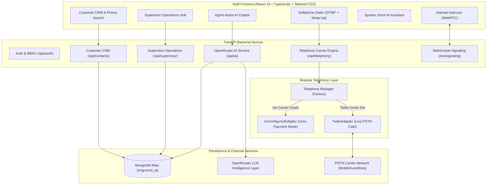

# OnGround AI — Intelligent Call Centre Platform

> **Full-Stack Call-Centre Staff Application featuring Customer CRM with Phone Lookup, Click-to-Call Softphone Dialer, Modular Telephony Carrier Architecture, Real-Time Agent Assist AI Copilot, Spoken Voice AI, and Supervisor Operations Oversight.**

---

## 1. System Overview

**OnGround AI** is a professional, enterprise-grade call-centre staff application built for front-line agents, supervisors, and operations teams. Designed from the ground up as a true call-centre workflow platform rather than a peer-to-peer demo, it integrates:

1. **Role-Based Call Centre Workflows (RBAC)**:
   - **Staff Agent**: Manage live availability, search assigned customers, launch Click-to-Call from CRM, utilize real-time Agent Assist AI coaching, and log post-call outcomes and follow-ups.
   - **Supervisor**: Real-time workforce presence matrix, live queue monitoring (unassigned customers & pending follow-ups), 1-click workload reassignment, and aggregate call-centre analytics.
   - **Administrator**: System diagnostics, carrier integration settings, and operational logs.
2. **Customer CRM & Phone Directory**:
   - Normalized E.164 telephone number search and customer name lookup.
   - Customer interaction timeline: past calls, durations, transcripts, categorized outcomes, and AI executive summaries.
   - Follow-up task scheduler with status tracking (`pending`, `completed`, `overdue`).
3. **Browser Softphone Dialer**:
   - Full E.164 international dialer with authentic audio DTMF tone feedback.
   - Click-to-Call directly from any CRM customer profile.
   - In-call controls (Mute, Hold, Keypad toggle, live duration timer).
   - Integrated Post-Call Wrap-Up modal: Outcome categorization (`interested`, `callback_requested`, `voicemail`, `resolved`, `escalated`, `no_answer`, `busy`, `wrong_number`), call notes, and follow-up creation.
4. **Modular Telephony Carrier Engine**:
   - Pluggable carrier adapter architecture (`TelephonyProvider` interface).
   - **Zero-Payment Constraint Honesty**: Zero mock calls, zero synthetic dial tones, zero fake phone numbers. When no paid PSTN carrier credentials exist in `.env`, the system operates in transparent Zero-Payment Mode, providing detailed diagnostic guides without faking connection states.
   - **Twilio Voice Integration**: Full carrier adapter ready to bridge browser softphone to PSTN mobile/landlines when credentials are provided in `.env`.
5. **Real-Time Agent Assist AI Copilot**:
   - Live AI coaching powered by OpenRouter LLM reasoning.
   - Analyzes customer statements, extracts core needs and objections, recommends immediate spoken responses (with 1-click copy and text-to-speech preview), and generates follow-up action items.
6. **Spoken Voice AI & CRM-Grounded Text AI**:
   - Hands-free spoken voice assistant with real microphone speech recognition and speech synthesis.
   - Text AI chat grounded in customer CRM profile and past interaction history.
7. **Internal Intercom (WebRTC)**:
   - Internal colleague audio calling across browser sessions using authenticated WebSocket signaling and STUN NAT traversal.

---

## 2. Architecture & Call-Centre Flow



---

## 3. Technology Stack

- **Frontend**:
  - React 19 + Vite + TypeScript
  - Tailwind CSS v4
  - Lucide React
  - Web Audio API (DTMF audio tone synthesis)
  - Native Web Speech API (`webkitSpeechRecognition`, `SpeechSynthesis`)
  - WebRTC (`RTCPeerConnection`, `getUserMedia`)
- **Backend**:
  - Python 3.14 + FastAPI
  - Uvicorn (Asynchronous server with hot-reload)
  - Motor + PyMongo (MongoDB Atlas async driver with DNS resolver & TLS resilience)
  - PyJWT + Bcrypt (Role-based access control and password hashing)
  - HTTPX (Async OpenRouter LLM client)
  - Twilio Voice SDK (Modular carrier integration)
  - WebSockets (Encrypted real-time peer signaling)
- **Database**:
  - MongoDB Atlas Cloud Database (`onground_ai`)
  - Collections: `users`, `contacts`, `calls`, `follow_ups`, `transcripts`, `conversations`, `messages`
- **AI Intelligence Layer**:
  - OpenRouter API (`openrouter/auto`)

---

## 4. Zero-Payment Constraint & Telephony Carrier Architecture

### Transparent Telephony Notice
In adherence to the platform's non-negotiable guidelines:
- **No Paid Upgrades or Subscriptions Required**: The platform functions 100% with free tools and services.
- **Never Faked or Simulated**: Real telephone calling to ordinary mobile or landline numbers requires paid PSTN carrier services (e.g. Twilio Voice or SIP trunk). The application **never plays fake dial tones, invents simulated phone numbers, or displays false connected statuses**.
- **Modular Adapter Pattern**: Telephony is fully modularized in `backend/app/telephony/`:
  - `UnconfiguredAdapter`: Provides honest status diagnostics explaining carrier configuration without crashing or simulating calls.
  - `TwilioAdapter`: When Twilio credentials (`TWILIO_ACCOUNT_SID`, `TWILIO_AUTH_TOKEN`, `TWILIO_PHONE_NUMBER`) are placed in `.env`, genuine PSTN calling immediately activates without modifying any code.
  - `Internal WebRTC Intercom`: Browser-to-browser internal calling remains available as a secondary staff communication feature.

---

## 5. User Roles & Capabilities

| Capability | Staff Agent | Supervisor | Administrator |
| :--- | :---: | :---: | :---: |
| Manage Live Availability (`available`, `busy`, `away`, `offline`) | ✅ | ✅ | ✅ |
| Access Customer CRM & Search by Phone / Name | ✅ (Assigned) | ✅ (All) | ✅ (All) |
| Click-to-Call Softphone with Outcome Wrap-Up | ✅ | ✅ | ✅ |
| Real-Time Agent Assist AI Copilot | ✅ | ✅ | ✅ |
| Hands-Free Spoken Voice AI & Grounded Chat | ✅ | ✅ | ✅ |
| Internal WebRTC Intercom Calling | ✅ | ✅ | ✅ |
| Monitor Real-Time Workforce Presence Matrix | ❌ | ✅ | ✅ |
| View Unassigned Queues & Pending Follow-Ups | ❌ | ✅ | ✅ |
| Reassign Customer Workloads Between Agents | ❌ | ✅ | ✅ |
| View Aggregate Call-Centre Metrics & Outcome Breakdown | ❌ | ✅ | ✅ |
| Configure Telephony Carrier Environment Settings | ❌ | ❌ | ✅ |

---

## 6. Environment Variables

Create `backend/.env`:

```env
# MongoDB Atlas Database
MONGODB_URI=mongodb+srv://<username>:<password>@cluster0.7au2y3m.mongodb.net/onground_ai?appName=OnGroundAI
MONGODB_DATABASE=onground_ai

# OpenRouter AI Engine
OPENROUTER_API_KEY=sk-or-v1-your-openrouter-key
OPENROUTER_MODEL=openrouter/auto

# Security & CORS
FRONTEND_ORIGIN=http://localhost:5173
JWT_SECRET=onground_ai_jwt_secret_key_prod_2026_secure

# Modular Carrier Telephony (Optional - Zero-Payment Mode active if empty)
TELEPHONY_PROVIDER=auto
TWILIO_ACCOUNT_SID=
TWILIO_AUTH_TOKEN=
TWILIO_PHONE_NUMBER=
TWILIO_TWIML_APP_SID=
PUBLIC_BASE_URL=http://localhost:8000
```

> [!NOTE]
> All credentials must be loaded via environment variables. Never commit credentials to version control. `.gitignore` is configured to exclude `.env` files.

---

## 7. Installation & Local Development

### Prerequisites
- Node.js v18+ (Node v24 tested)
- Python 3.10+ (Python 3.14 tested)
- MongoDB Atlas cluster

### 1. Backend Service

```powershell
# In project root
.\venv\Scripts\Activate.ps1

# Install dependencies
pip install -r backend/requirements.txt

# Run automated test suite (19/19 tests)
$env:PYTHONPATH="backend"; pytest backend/tests -v

# Start FastAPI backend server with reload
$env:PYTHONPATH="backend"; python -m uvicorn app.main:app --host 127.0.0.1 --port 8000 --reload
```

Interactive API documentation will be available at: `http://127.0.0.1:8000/docs`.

### 2. Frontend Application

```powershell
cd frontend

# Install npm dependencies
npm install

# Run TypeScript build verification
npm run build

# Start Vite development server
npm run dev
```

Open `http://localhost:5173` in your browser.

---

## 8. Verification & Test Suite Summary

- **19/19 Automated Pytest Tests Passing** (`backend/tests/`):
  - `test_telephony.py`: Unconfigured adapter honest diagnostics, fake dialing prevention, manager factory.
  - `test_crm_and_supervisor.py`: E.164 phone normalization, contact schema validation, follow-up scheduler, outcome enums.
  - `test_ai.py`: OpenRouter LLM response generation, rate limit handling, transcript summarization.
  - `test_auth.py`: Bcrypt password hashing, JWT token lifecycle, invalid token rejection.
  - `test_calls.py`: Call lifecycle schemas, wrap-up outcomes.
  - `test_signaling.py`: WebSocket manager presence, SDP offer routing.
- **Frontend Build**: `tsc -b && vite build` built cleanly with 0 errors (`dist/index.html` generated in under 2s).
- **End-to-End Multi-Agent Lifecycle Test**: Passed with supervisor registration, agent registration, CRM contact creation, normalized phone search, follow-up scheduling, carrier guard verification, and live OpenRouter Agent Assist generation.

---

## 9. AI Tools & Provenance

- Architecture and development performed in collaboration with **Antigravity** (Google DeepMind Advanced Agentic Coding Assistant).
- Real-time LLM intelligence powered by **OpenRouter API** (`openrouter/auto`).
