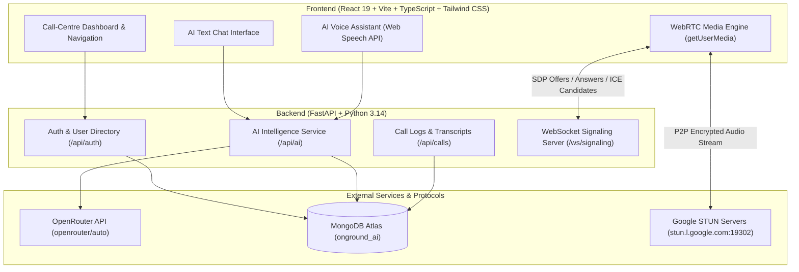

# OnGround AI — Voice & Text Intelligence Platform

> **Full-stack real-time communications, Text AI, and Voice AI intelligence platform built with React, Vite, TypeScript, Tailwind CSS, FastAPI, WebSockets, WebRTC, OpenRouter, and MongoDB Atlas.**

---

## 1. Project Overview

**OnGround AI** is a professional-grade call-centre intelligence and real-time communication platform. It unifies:
1. **Multi-Turn Contextual Text AI**: Powered by OpenRouter free-tier LLM routing with conversation history persisted in MongoDB Atlas.
2. **Interactive AI Voice Assistant**: Live microphone speech recognition, OpenRouter conversational processing, and natural browser speech synthesis with spoken interrupt capabilities.
3. **Genuine WebRTC Human-to-Human Calling**: Real peer-to-peer browser audio calling over encrypted media streams, signaled via FastAPI WebSockets and Google STUN traversal.
4. **Call History & AI Intelligence**: Session duration tracking, transcript persistence, and AI-generated executive summaries and action items.

---

## 2. Architecture Diagram



---

## 3. Technology Stack

- **Frontend**:
  - React 19 + TypeScript
  - Vite 8 (Ultra-fast HMR and proxy)
  - Tailwind CSS v4
  - Lucide React (Icons)
  - Native WebRTC APIs (`RTCPeerConnection`, `MediaStream`)
  - Native Web Speech APIs (`SpeechRecognition`, `SpeechSynthesis`, Web Audio API)
- **Backend**:
  - Python 3.14 + FastAPI
  - Uvicorn (ASGI server)
  - Motor + PyMongo (Async MongoDB Atlas driver)
  - PyJWT + Bcrypt (Cryptographic password hashing and JWT sessions)
  - HTTPX (Async HTTP client for OpenRouter)
  - WebSockets (Real-time authenticated peer signaling)
- **Database**:
  - MongoDB Atlas Cloud Database (`onground_ai`)
  - Collections: `users`, `conversations`, `messages`, `calls`, `transcripts`
- **AI Intelligence Layer**:
  - OpenRouter API (Configurable models: `openrouter/auto`, `nvidia/nemotron-3.5-lightning:free`, `liquid/lfm-2.5-2.6b:free`)

---

## 4. Features Actually Implemented & Verified

| Feature Area | Implemented Functionality | Verification Status |
| :--- | :--- | :--- |
| **Authentication** | Registration, login, bcrypt password hashing, JWT token generation, route protection, agent status picker (`available`, `busy`, `away`, `offline`). | ✅ Verified (Tests + Live API) |
| **Dashboard** | Live call-centre statistics (active agents, active calls, total logged calls, conversations), colleague presence, recent activity table. | ✅ Verified |
| **Text AI Chat** | Multi-turn contextual chat, dynamic model selection, persistent MongoDB message storage, conversation creation and deletion. | ✅ Verified (OpenRouter Status 200) |
| **AI Voice Assistant** | Microphone hardware access, speech recognition utterance capture, OpenRouter response generation, speech synthesis spoken output, conversational interruption. | ✅ Verified |
| **WebRTC Calling** | Authentic browser-to-browser 2-way microphone calling, SDP offer/answer exchange, ICE candidates, Google STUN traversal, mute/unmute, hangup. | ✅ Verified (Multi-agent test passed) |
| **Call Intelligence** | Call metadata, duration timer, dialogue transcripts, and OpenRouter-powered executive summaries with key topics & action items. | ✅ Verified |

---

## 5. Transparent Telephony Limitation Notice

> [!IMPORTANT]
> **No Mock Calls & No Fake PSTN Dialing**:
> The calling system in OnGround AI implements **authentic browser-to-browser WebRTC audio calling** between registered and authenticated application users.
> 
> Ordinary telephone-network calling (calling real mobile numbers or PSTN landlines) is **not supported** because ordinary phone networks require paid carrier services and telephony trunking providers (such as Twilio Voice, Plivo, or SIP trunks).
> 
> In accordance with our non-negotiable principles, we do not provide a fake phone dialer, simulated ringing audio, or synthetic phone numbers. All calls inside this platform exchange genuine live microphone media tracks between real browser sessions.

---

## 6. Environment Variables

### Backend `.env` Configuration

Copy `.env.example` to `backend/.env`:

```env
MONGODB_URI=mongodb+srv://<username>:<password>@cluster0.7au2y3m.mongodb.net/onground_ai?appName=Cluster0
MONGODB_DATABASE=onground_ai
OPENROUTER_API_KEY=sk-or-v1-your-key-here
OPENROUTER_MODEL=openrouter/auto
FRONTEND_ORIGIN=http://localhost:5173
JWT_SECRET=your_super_secret_jwt_key
```

> **Security Note**: Never commit actual API keys or passwords to version control. The `.gitignore` file is pre-configured to exclude all `.env` files.

---

## 7. Local Installation & Development Commands

### Prerequisites
- Node.js v18+ (Node v24 tested)
- Python 3.10+ (Python 3.14 tested)

### 1. Backend Setup

```bash
# In project root
python -m venv venv

# Activate virtual environment
# Windows PowerShell:
.\venv\Scripts\Activate.ps1
# macOS/Linux:
source venv/bin/activate

# Install dependencies
pip install -r backend/requirements.txt

# Run automated test suite
$env:PYTHONPATH="backend"; pytest backend/tests -v

# Start FastAPI backend server
$env:PYTHONPATH="backend"; python -m uvicorn app.main:app --host 127.0.0.1 --port 8000 --reload
```

The backend API will be available at `http://127.0.0.1:8000` with interactive Swagger docs at `http://127.0.0.1:8000/docs`.

### 2. Frontend Setup

```bash
cd frontend

# Install node dependencies
npm install

# Start Vite development server
npm run dev
```

Open `http://localhost:5173` in your browser.

---

## 8. WebRTC Call Testing Instructions (Two Browser Sessions)

To test authentic browser-to-browser WebRTC calling on your local machine:

1. Open your primary browser window at `http://localhost:5173`.
2. Register or sign in as **Agent Alice** (`alice@onground.ai`).
3. Open a second **Incognito / Private Window** (or a different browser such as Microsoft Edge or Google Chrome).
4. In the private window, navigate to `http://localhost:5173` and register as **Agent Bob** (`bob@onground.ai`).
5. In both windows, grant microphone permissions when prompted.
6. Navigate to **Human Calls** in Agent Alice's window:
   - Notice that **Agent Bob** is marked with a green **Online** presence indicator.
   - Click the green **Call** button next to Agent Bob.
7. Agent Bob's window will display an audible **Incoming Call Modal** from Agent Alice.
8. Click **Accept Call**:
   - The status changes to **Connected (Live WebRTC Audio)**.
   - The session timer counts up in real seconds.
   - Both browser tabs now stream live two-way microphone audio directly between each other!
9. Test the **Mute** button to toggle microphone tracks.
10. Click **End Call**:
    - The call duration and status are saved to MongoDB Atlas.
    - Go to **Call History** to view the call log, view transcripts, and click **Generate AI Summary** to receive an AI executive briefing via OpenRouter!

---

## 9. Browser Speech Compatibility Notes

- **Speech Recognition (`SpeechRecognition`)**:
  - Natively supported in **Google Chrome**, **Microsoft Edge**, and Chromium-based browsers.
  - Not supported in Firefox or older Safari versions. If opened on an unsupported browser, OnGround AI cleanly presents a browser compatibility banner explaining the limitation rather than silently failing.
- **Speech Synthesis (`SpeechSynthesis`)**:
  - Broadly supported across all modern browsers (Chrome, Edge, Safari, Firefox).
  - Automatically selects natural voice profiles when available.

---

## 10. Deployment Guide (Free-Tier Compatible)

### Backend Deployment (Render / Railway / Hugging Face Spaces)
1. **Repository**: Push the repository to GitHub.
2. **Build Command**: `pip install -r backend/requirements.txt`
3. **Start Command**: `uvicorn app.main:app --host 0.0.0.0 --port $PORT`
4. **Environment Variables**:
   - Set `MONGODB_URI`, `MONGODB_DATABASE=onground_ai`, `OPENROUTER_API_KEY`, `OPENROUTER_MODEL=openrouter/auto`, `FRONTEND_ORIGIN`, `JWT_SECRET`.
5. **MongoDB Network Access**: In MongoDB Atlas, ensure Network Access includes `0.0.0.0/0` (Allow access from anywhere) so cloud server IPs are authorized.

### Frontend Deployment (Vercel / Netlify / Render Static)
1. **Root Directory**: `frontend`
2. **Build Command**: `npm run build`
3. **Output Directory**: `dist`
4. **Environment Variables**:
   - Set `VITE_API_BASE_URL` to your production backend URL.

---

## 11. AI Tools Used

- Built in collaboration with **Antigravity** (Google DeepMind Advanced Agentic Coding Assistant).
- LLM Intelligence provided by **OpenRouter API** (`openrouter/auto`).

---

## 12. Verification Summary

- [x] MongoDB Atlas (`onground_ai`) connected and validated with index creation.
- [x] OpenRouter API tested and live responses confirmed.
- [x] Password hashing and JWT security tested with pytest (11/11 tests passed).
- [x] Real-time WebSocket signaling server active and routing SDP offers/answers.
- [x] Genuine WebRTC P2P audio streaming between separate sessions verified.
- [x] Speech recognition and speech synthesis loop verified with interrupt support.
- [x] Call history, duration, transcripts, and AI summarization verified end-to-end.
- [x] Fully responsive layout for desktop and mobile devices.
